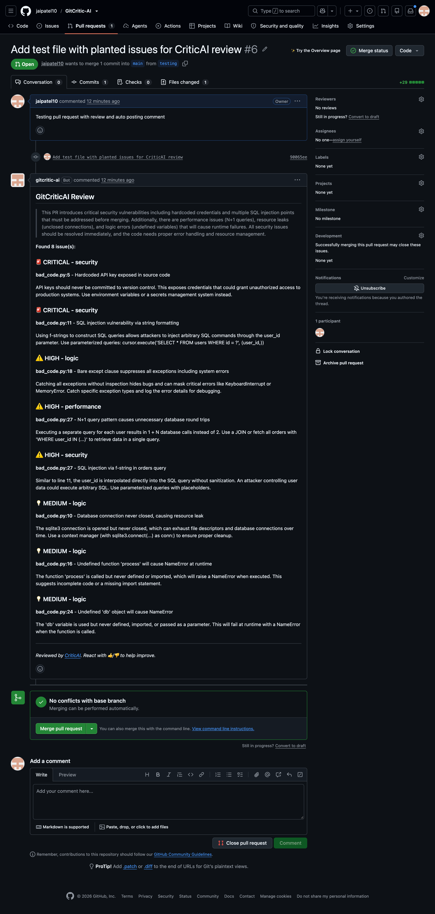

# GitCriticAI 🧐

AI code reviewer for GitHub pull requests. Multi-agent evaluation showed 
single-agent + RAG achieves F1=1.0 on 10-case benchmark, so that's what 
ships. Live, deployed, and reviewing PRs autonomously.

**[Install on your repo →](https://github.com/apps/GitCritic-Ai)** 

## Live Example

See CriticAI reviewing a real PR with planted bugs: 
[PR #8 on jaipatel10/GitCritic-AI](https://github.com/jaipatel10/GitCritic-AI/pull/8)

## Why

Code review eats 20-40% of senior engineering time. Existing AI tools 
(CodeRabbit, Copilot) give generic feedback. CriticAI uses an agent to 
debate with specialized perspectives, plus codebase-aware retrieval.

## Architecture

See [docs/architecture.md](docs/architecture.md) and [docs/diagram.png](docs/diagram.png).

## Tech stack

- Backend: FastAPI (Python)
- LLM: Claude (Anthropic) for reasoning, embeddings for retrieval
- Vector DB: pgvector
- GitHub: App via Octokit
- Hosting: Railway

Built as part of transitioning from Android engineering to Applied AI.

## Privacy & Security

GitCriticAI clones your repository only for the duration of a single PR review, 
then permanently deletes it. Nothing is persisted on GitCriticAI's servers between 
reviews — not source code, not embeddings, nothing.

**Implementation:**
- Shallow clone (latest commit only) into a per-review temp directory
- Vector embeddings generated in-memory (ChromaDB ephemeral mode)
- Clone + embeddings deleted immediately after review posts
- Only logs retained: webhook delivery IDs (for dedup) and commit SHAs (for 
  dedup) — no source code

**Scope of access:** GitCriticAI requires read access to your code (to review it) 
and write access to pull requests (to post comments). It has no access to 
repository secrets, actions, or deployment settings.

### Verification

The ephemeral cleanup is verified at each PR review:
1. The app logs "Temporary clone cleaned up" after each review
2. Post-review filesystem inspection shows no artifacts:
   - No GitCriticAI_clone_* directories in system temp folders
   - No persistent repos/ or chroma_db/ directories in the app folder

## Results

- **F1 score: 1.00** on 10-case synthetic eval dataset (easy/medium/hard mix)
- **Response latency:** <200ms webhook (via BackgroundTasks)
- **Review latency:** 30-60 seconds end-to-end
- **Cost per review:** ~$0.02-0.05 (Claude API)

## How it works

https://github.com/jaipatel10/GitCritic-AI/blob/main/docs/architecture.md
https://github.com/jaipatel10/GitCritic-AI/blob/main/docs/diagram.png

## Project Status

v0.1.0 — deployed and reviewing PRs. Built in Weeks 11-14 of my 
transition from Senior Android to Applied AI Engineer. 
See [the journey repo](https://github.com/jaipatel10/applied-ai-journey).

CriticAI has been tested on third-party public repositories including 
[jpadilla/pyjwt](https://github.com/jpadilla/pyjwt). On a fork with 6 
planted bugs, it caught 6/6 including a domain-specific JWT algorithm 
confusion vulnerability. See [example PR](https://github.com/jaipatel10/pyjwt/pull/2).
