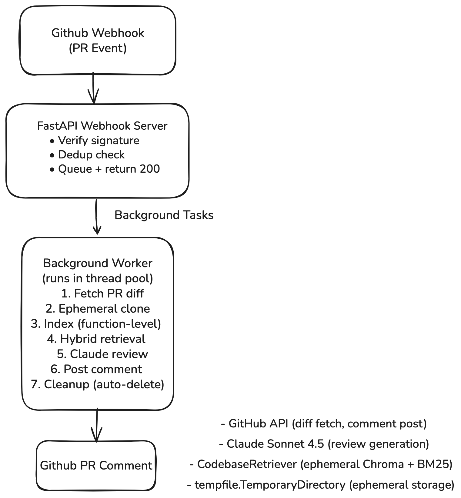

# GitCriticAI Architecture

## Overview

GitCriticAI is a GitHub App that reviews pull requests using a single Claude 
Sonnet 4.5 agent augmented with codebase-aware retrieval (RAG). Reviews 
post as PR comments within 30-60 seconds of opening or updating a PR.

## Design decision: single-agent vs multi-agent

The original architecture (see git history) specified 4 specialized agents 
(security, performance, logic, style) plus a synthesizer. During eval-driven 
development, this was **evaluated and rejected based on data**:

- Built a 10-case synthetic eval dataset covering all 4 categories at 
  easy/medium/hard difficulty
- Single-agent + RAG achieved **F1=1.0 on all 10 cases**
- No evidence multi-agent would meaningfully improve on this result
- Complexity has real cost (4x API calls, synthesis latency, debugging burden)

**Decision rule applied:** simpler architecture ships unless measurement 
shows it's insufficient. Multi-agent remains documented in roadmap for 
revisit if production evals on complex multi-file PRs reveal gaps.

## System flow

1. GitHub sends webhook on `opened` or `synchronize` events
2. FastAPI webhook server:
   - Verifies HMAC-SHA256 signature
   - Dedups by delivery ID + commit SHA
   - Queues review as background task
   - Returns HTTP 200 (within <200ms)
3. Background task (runs in thread pool):
   - Fetches PR diff from GitHub API
   - Ephemeral-clones target repo to temp directory
   - Indexes Python code chunks (function-level AST)
   - Hybrid retrieval (dense embeddings + BM25 with RRF fusion)
   - Sends diff + retrieved context to Claude
   - Parses + validates findings against Pydantic schema
   - Posts formatted review as PR comment
   - Saves SHA for future dedup
4. Temp directory auto-deletes (via Python `TemporaryDirectory`)

## Components

- **FastAPI** webhook server
- **GitHub App auth:** JWT → installation token exchange
- **Ephemeral cloning:** `tempfile.TemporaryDirectory` with git credentials 
  passed via `GIT_CONFIG_*` env vars (not URL-embedded, more secure)
- **CodebaseRetriever:** ChromaDB `EphemeralClient` + `sentence-transformers` 
  (`all-MiniLM-L6-v2`) + `BM25Okapi` with RRF fusion (alpha=0.5)
- **Claude Sonnet 4.5** for review generation
- **No persistent storage** of source code or embeddings between reviews

## Measured performance

Based on 10-case synthetic eval dataset:
- F1 = 1.00 across all cases
- Mean latency: 30-60 seconds per review
- Cost: ~$0.02-0.05 per review (Claude API)
- Webhook response: <200ms (due to BackgroundTasks)

Dedup: delivery ID (prevents GitHub retry duplication) + commit SHA 
(prevents re-review of same code).

## Privacy & security

GitCriticAI clones your repository only for the duration of a single review, 
then permanently deletes it. Nothing persists on GitCriticAI's servers:
- Shallow clone (latest commit only) into a per-review temp directory
- Vector embeddings generated in-memory (ChromaDB ephemeral mode)
- Clone + embeddings deleted immediately after review posts
- Git auth credentials passed via environment (never in process args or 
  `.git/config`)
- Only logs retained: webhook delivery IDs + commit SHAs (for dedup) — 
  never source code

## Key trade-offs

- **Latency:** Each review clones + indexes freshly (~5-10s overhead) in 
  exchange for not persisting user code. Acceptable since Claude call is 
  the dominant latency anyway.
- **Scalability:** Current architecture handles sequential reviews well. 
  For high-volume (100+ PRs/day) deployments, would need: worker queue 
  (Celery), per-installation clone cache, or GitHub API-based retrieval.
- **Language support:** Python-only for RAG chunking (AST-based). Other 
  languages would use diff-only review without codebase context.

## Out of scope

- Non-Python codebases (for RAG; diff-only review works for any language)
- Auto-applying code suggestions
- IDE integration
- Multi-agent orchestration (shelved — see "Design decision" above)
- Persistent per-installation cache (future scaling work)