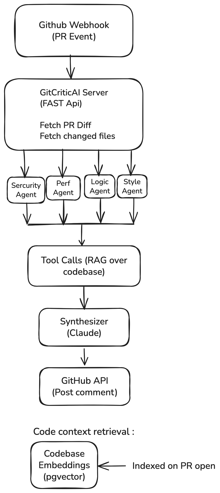

# GitCriticAI Architecture

## Overview

GitCriticAI is a GitHub app that reviews pull requests using four specialized 
AI agents (security, performance, logic, style) running in parallel. A 
synthesizer agent consolidates their findings into a single ranked comment 
posted to the PR.

## Problem

Senior engineers spend 20-40% of time on PR reviews. Existing 
AI tools produce generic feedback. Most reviews repeat the same boring checks 
while missing hard cases (logic bugs, security issues)

## System diagram

## Components

### GitHub Webhook Receiver
Receives `pull_request` events from GitHub. Deduplicates by delivery ID. 
Validates webhook signature. Forwards verified events to the orchestrator.

### Orchestrator
Fetches the PR diff and changed files from GitHub API. Launches 4 agents 
in parallel with the diff + their allowed tool set. Collects results.

Decision: parallel execution over sequential — agents are independent, 
and parallel gives 4× speedup at the same cost.

### The 4 Reviewer Agents
Each agent is a Claude call with a specialized system prompt and a 
restricted toolset:

- **Security Agent** — focus: injection, auth bypasses, exposed secrets, 
  unsafe deserialization. Tools: `read_file`, `search_codebase`, 
  `check_dependencies_cves`.
- **Performance Agent** — focus: N+1 queries, inefficient algorithms, 
  memory issues. Tools: `read_file`, `search_codebase`, `get_db_schema`.
- **Logic Agent** — focus: edge cases, null handling, race conditions, 
  correctness. Tools: `read_file`, `get_tests_for_file`, `get_function_definition`.
- **Style Agent** — focus: naming, conventions, unused code, missing types. 
  Tools: `read_file`, `get_project_conventions`.

Each returns a JSON list of findings: `{severity, file, line, message, rationale}`.

### Synthesizer
Takes 4 agent outputs. Removes duplicates. Ranks by severity. Produces 
one PR comment in GitHub-flavored markdown.

Decision: synthesizer is a separate LLM call rather than aggregating 
programmatically. Reasoning: deduplication requires semantic understanding 
(two agents may describe the same bug differently); ranking requires 
judgment, not just ordering.

### Codebase Retrieval (RAG)
When an agent calls `search_codebase`, the query performs semantic search 
over indexed repository content.

**TBD — design decision pending (Week 12 of my learning plan):**
- Vector store: choosing between pgvector (Postgres extension) and Chroma 
  (standalone) based on hands-on comparison in Week 12.
- Embedding model: evaluating OpenAI's text-embedding-3, Voyage, and 
  open-source sentence-transformers for code specifically.
- Chunking strategy: file-level vs function-level vs semantic — will 
  test multiple strategies and measure retrieval quality.

Deferred to the build phase after I've worked hands-on with these 
components. See Week 12 learning plan.

## Data flow (end-to-end example)

1. Developer opens PR on their repo with GitCriticAI installed
2. GitHub sends webhook → GitCriticAI verifies signature and delivery ID
3. Orchestrator fetches PR diff via GitHub API
4. Orchestrator launches 4 agents in parallel, each with the diff
5. Each agent may call tools 0-5 times (`read_file`, `search_codebase`, etc.)
6. Each agent returns a list of findings
7. Synthesizer receives all 4 lists, produces one markdown comment
8. GitCriticAI posts comment via GitHub API

Expected latency: 30-60 seconds per PR. Expected cost: ~$0.10-0.30 per PR.

## Key design decisions

 **Multi-agent vs monolithic prompt:** Multi-agent. Isolates concerns 
  and prevents one agent's bias from affecting others.
- **Claude for agents:** Claude 4.5 Sonnet initially; will test multi-provider 
  in evals (Week 14).
- **Stateless agents:** No memory between PRs. Each review is independent.
- **Retrieval strategy:** TBD — see Codebase Retrieval section above.

## Trade-offs

- **Cost:** 5 LLM calls per PR (4 agents + 1 synthesizer). ~$0.10-0.30. 
  Acceptable for serious use, too expensive for every commit.
- **Latency:** 30-60 seconds. Not real-time, but acceptable since developers 
  context-switch after opening a PR anyway.
- **Accuracy:** TBD. Will measure precision/recall on 50-PR eval set in Week 14.

## Out of scope (MVP)

- Languages beyond Python + TypeScript
- Auto-approving PRs
- Writing code fixes (reviews only)
- IDE integration
- Multi-repository org-level configuration

## Open questions

- What's the right severity threshold for posting a comment vs staying silent?
- How does GitCriticAI handle very large PRs (1000+ lines)?
- Should the Logic Agent read the actual test files, or is coverage sufficient?
- What's the cost ceiling where GitCriticAI stops being worth it?